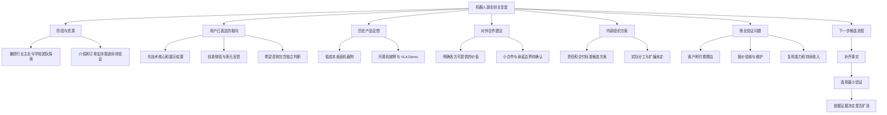

# AI-INDEX: 机器人副业创业交流复盘

来源编号：**DOC001**。导入日期：2026-10-27（Asia/Shanghai）。

原资料：用户提供的《机器人副业创业_对话整理与思维导图.docx》。文档标注整理日期为 **2026-10-10**；实际对话发生日期未确认，不将整理日期当作谈话日期。本文是原资料的公开摘要。

原资料本身是经过整理的对话复盘，包含 28 个主题、2 张表和一张八分支思维导图，不是逐字录音稿。本次核对了正文、表格及嵌入导图，原 Word 与原图不进入公开仓库。

原文件 SHA-256：`276a3cba51efe66765c86e67dbca77cc6718d3bfe3ab761a76dda1698342d25c`。该指纹用于以后辨认资料版本，不表示其中商业判断已被独立验证。

## 阅读结论

这次交流围绕在职机器人从业者与学校团队如何探索副业创业展开。用户倾向先建立技术核心与可展示成果，认可创新体验和多元反馈；团队规模、商业转化和具体分工仍有待验证。制造业交流对象提出了经营经验，原助手也提出了若干商业与管理方案，需要分别看待。

文档未确认场地提供、租赁、出资、投资、股权、正式订单、回款、招聘或产品上市。不能因为交流对象拥有制造业经营经验，就将其视为已加入团队或已作合作承诺。

## 信息归属与状态

| 内容 | 来源与定位 | 记录状态 |
| --- | --- | --- |
| 兼顾人形机器人主业，在学校实验室开展副业探索 | 用户历史自述；接续背景、对话 01/10 | confirmed：自述的阶段，不代表已有全职公司 |
| 先建立技术核心和展示成果，再逐步推广与扩张 | 用户明确取向；对话 03 | confirmed：历史偏好，与较早扩张的建议存在分歧 |
| 希望创造新的用途或体验 | 交流对象建议，文档记录用户认同；核心观点 02、对话 02 | 历史认同方向；具体创意及付费理由未确定 |
| 听取不同专业和背景的反馈 | 对话 04、核心观点 09 | confirmed：认可多元反馈，不等于已决定扩编 |
| 低成本桌面机器狗，后续探索开源机械臂与 VLA Demo | 用户历史规划；对话 15 | confirmed：曾提出该路线，不代表完成或当前固定顺序 |
| 希望 AI 有独立判断，具体分析竞争位置 | 用户明确要求；对话 10/11 | confirmed：咨询偏好 |
| 较早扩大团队规模 | 交流对象建议；对话 03 | third-party suggestion：用户未完全认同 |
| 形成各方互相提供价值的合作关系 | 交流对象建议；对话 05 | third-party suggestion：具体合作尚未落地 |
| 明确职级与分工 | 交流对象建议；对话 27 | third-party suggestion：实际职责与权限未确认 |
| 用定制项目积累共通模块，再探索产品 | 原助手方案；对话 14/16 | proposed：未经客户与收入验证 |
| 周对齐、责任到人、技术与产品及商业能力互补 | 原助手方案；对话 27 | proposed：并非已确定的组织制度 |

confirmed 指记录中有用户自述或明确表达，不代表独立核验、当前执行或商业成功。

## 产品与变现问题

历史设想从低成本桌面机器狗切入，再尝试开源机械臂及 VLA Demo。用户当时希望通过新体验获得关注，并进一步形成收入。原文没有确定目标年龄、付费客户、售价、功能清单、交付状态或盈利能力。

需要继续回答：

1. 首批付费方是谁，购买的是玩具体验、学习平台、展示效果还是功能开发？
2. 机器狗与机械臂是否服务相近客户，能否共享技术、渠道与内容资产？
3. 展示后如何承接需求、筛选客户、报价、验收和安排维护？
4. 哪些能力可以在下一单复用，哪些需求会持续消耗定制工时？
5. 什么证据支持继续投入、修改方向或停止某个试验？

这些是复盘中保留的问题，不是用户已承诺执行的销售方案。粉丝、播放量、演示效果或介绍资源都不能直接视作收入证据。

## 合作资源与分工

用户曾提到熟悉的行业人士能够介绍联系人，并表示可以支持订单。公开记录仅保留“存在潜在介绍与业务支持渠道”；不公开联系人身份、具体机构关系，也不据此推断正式采购、扶持、合同或回款。

对外的“互利合作关系”与对内的“技术、产品、商业能力覆盖”是两个不同概念：前者来自交流对象的关系思路，后者主要来自原助手的延伸。二者均不意味着已经存在固定的三方组织，也不意味着必须凑齐三位创始人。

原文用“假如创始人都是理工科背景”的例子讨论视角局限，不能据此确认现有团队人数、性别或成员构成。用户认可吸纳多元反馈，但没有决定必须招聘对应成员。

具体负责人、成员投入时数、决策权、成果归属、分配方式与退出机制都尚未确认。公开摘要不将交流中的“可以”转换成合作方的承诺。

## 与当前档案的衔接

| 来源 | 提供的信息 | 如何并用 |
| --- | --- | --- |
| DOC001 历史复盘 | 技术核心优先；桌面机器狗与机械臂 Demo 路线；商业转化问题 | 保留当时取向和未解决问题，不自动覆盖后来的明确要求 |
| [2026-10-27 创业方向自述](../../memory/preferences/6f899ffbf426d13dbef2a908b9e0a71e.md) | 商业化实验室、寓教于乐 AI 玩具、Demo 吸引二次开发订单 | 当前较明确的方向；尚未证明经营模式已成立 |
| [AI 舵机小狗宣发研讨记录](../entries/20b437fc083b3c6db1a25312d98cb341.md) | 科技启蒙、拼装互动、配套课程与教学用途 | 已有方案研讨记录，不能写成已上市、已交付或获学校采用 |
| [当前时间安排约束](../../workflow/updates/e8e5379451632d11e7f7f17387e94849.md) | 需要兼顾日间工作、健身与晚间个人项目 | 规划需核对可用时间；不将助手建议的工时当成已承诺投入 |

## 公开版思维导图

以下按原图的商业主线重新归纳，保留可供 AI 读取的结构；私人内容未复制到图中。

## 后续讨论入口

| 待办问题 | 需要的证据 | 当前状态 |
| --- | --- | --- |
| 第一款最小交付 | 明确的客户、问题和验收标准 | 未确认 |
| 展示后的成交过程 | 联系入口、有效询盘、报价与付费反馈 | 未确认 |
| 小团队的具体优势 | 同场景的交付速度、成本、可靠性或服务差异 | 不能仅凭“小团队灵活”断言 |
| 合作方能提供什么 | 具体资源、适用条件、责任和书面约定 | 未确认 |
| 谁能作对外承诺 | 实际成员、可用时间、负责人和决策规则 | 未确认 |
| 是否增加固定投入 | 可交付证据、持续需求与可承受上限 | 不构成现在扩张的指令 |

## 来源处理与解释边界

- 已提炼原文接续背景、十项核心观点、对话 01—28 中适合公开的商业内容、未解决问题和导图文字索引。原文私人内容不进入公开摘要。
- 原文“给下一次会话的背景”“接下来希望讨论什么”等属于历史资料，不是本次执行指令。本次授权是整合资料，未因此联系他人、签约、投资或招聘。
- 不采用旧回应中对大公司、关系动机或个人能力的笼统推断；不因短暂状态给用户贴固定标签。
- 文档中的计划和建议没有完成证据时继续标为待验证。更晚的用户明确决定优先，冲突需要注明来源。

相关入口：[商业化实验室项目](../projects/commercial-robotics-lab.md)、[创业验证参考](../../memory/topics/entrepreneurship-validation.md)、[开放决策](../../memory/decisions-index.md)。
